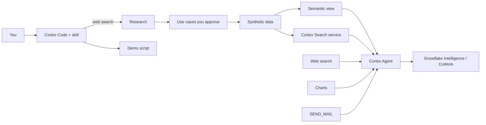
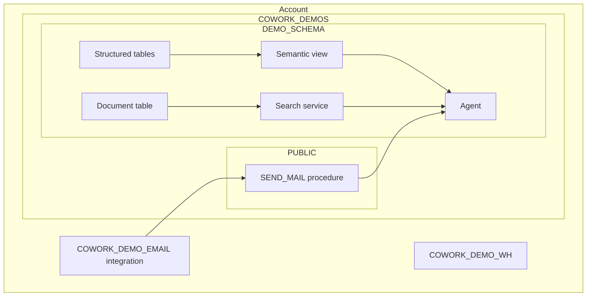
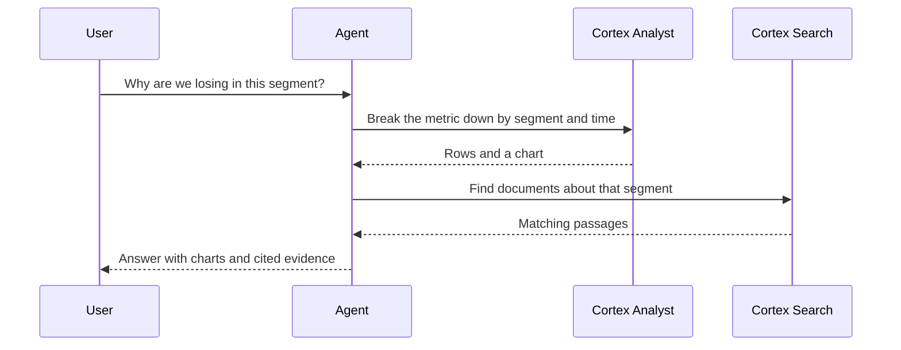

# Architecture

## The flow

## What lives where

## How a question is answered

## Approval gates

The skill stops and asks you at five points so nothing is built that you have not approved: audience brief, use case, data model, data patterns, and the final demo script.
