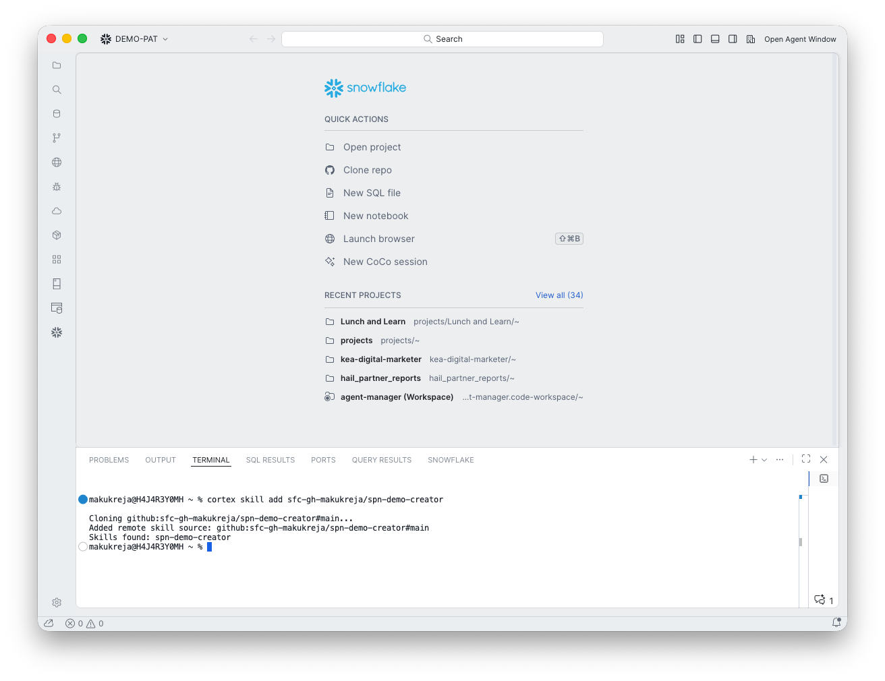
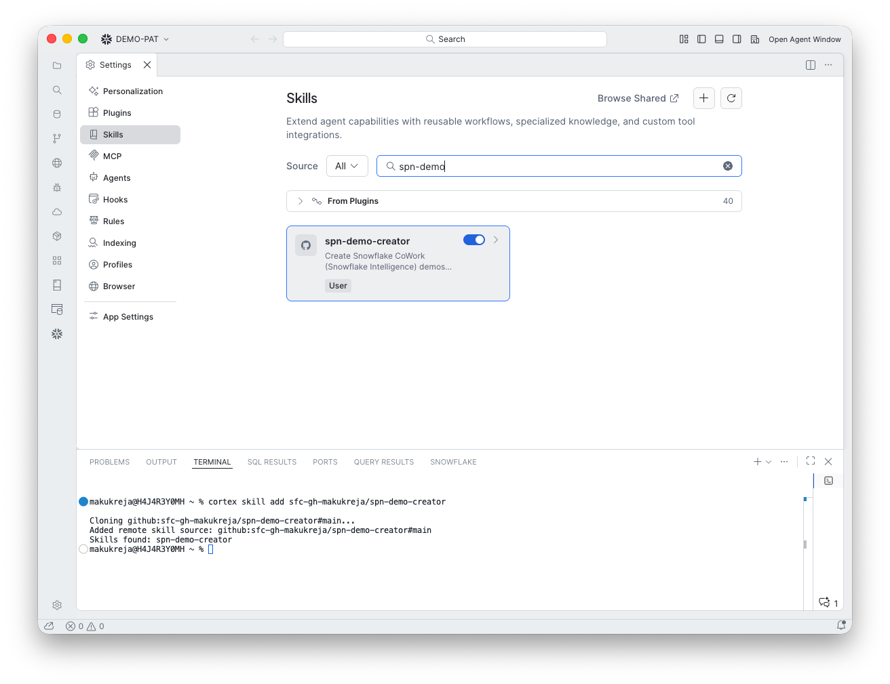
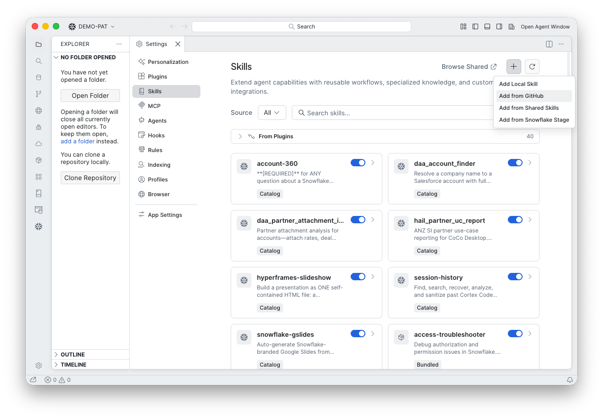
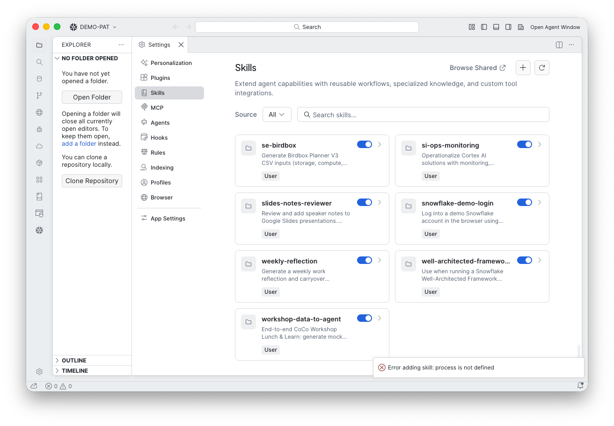

# Install the skill

The easiest way is to add it from GitHub in CoCo Desktop. CoCo clones the repo and finds the skill for you.

## Option 1: One command in the terminal (recommended)

Open the terminal in CoCo Desktop (or any terminal) and run:

```bash
cortex skill add sfc-gh-makukreja/spn-demo-creator
```

You should see `Skills found: spn-demo-creator`. Then open **Settings > Skills** in CoCo Desktop and search for `spn-demo`. The skill appears with the GitHub icon and a toggle that is on.





!!! note "Shared with Desktop"
    Skill settings are stored in `~/.snowflake/cortex/skills.json` and shared between CoCo Desktop and the `cortex` command-line tool. A skill added in one is available in the other. To get later changes, run the same command again, or use **Update** on the skill.

## Option 2: Add from GitHub in CoCo Desktop

1. Open **Agent Settings** (left sidebar) and select **Skills**.
2. Click **+** and choose Add from GitHub.
3. Enter `sfc-gh-makukreja/spn-demo-creator` and click **Add**.



!!! warning "Known issue"
    Some builds of CoCo Desktop show `Error adding skill: process is not defined` in this dialog. The repository is fine. Use Option 1 instead; the skill then appears in Desktop.



## Option 3: Local folder

Use this if you cannot reach GitHub or want to edit the skill.

1. Clone the repo:

    ```bash
    git clone https://github.com/sfc-gh-makukreja/spn-demo-creator.git ~/snowflake-skills/spn-demo-creator
    ```

2. In **Agent Settings > Skills**, click **+** in the **Local Skills** section and pick `~/snowflake-skills`.

CoCo scans up to 10 folders deep for a file named exactly `SKILL.md`.

## Option 4: Share inside your company

To give your own team the skill, publish it from the Skills tab: **Publish to stage** (a Snowflake stage you control) or **Publish to Skills Catalog** (a versioned object, with access through Snowflake roles).

## Run it

In chat, type `/` and pick `spn-demo-creator`, or ask for a demo and the agent picks the skill from its description:

> Create a CoWork demo for the retail industry

or

> Create a CoWork demo for https://www.example.com

You will see a "Using skill spn-demo-creator" line in the chat. Click it to open the `SKILL.md` the agent loaded.

<!-- screenshot: install-03-first-prompt.png -->

## If the skill does not show up

- Check it appears in **Agent Settings > Skills**.
- Check it is not in `snowflake.skills.disabledSkills`.
- If the clone fails, run `git clone <url>` in a terminal first to confirm your Git credentials.
