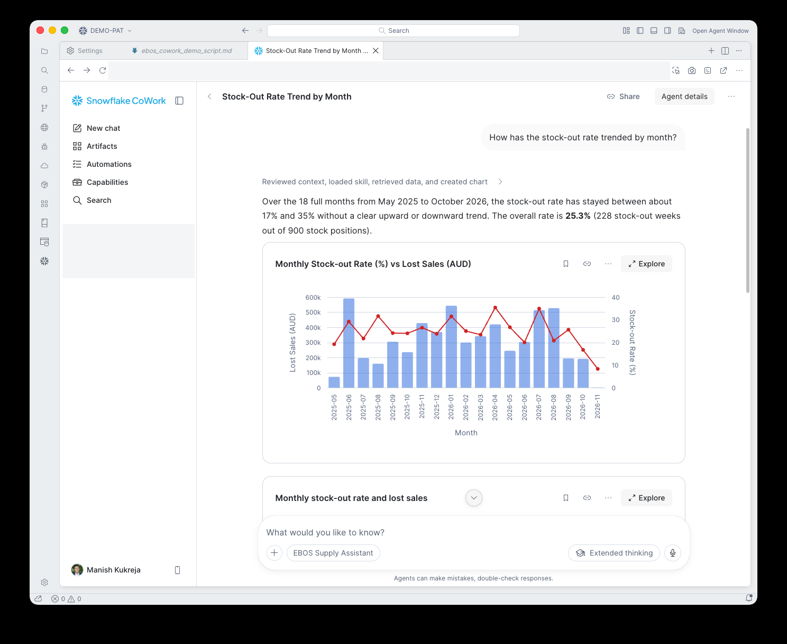

# Run the demo

About ten minutes.

1. Open `https://ai.snowflake.com` (Snowflake CoWork) and choose your agent from the picker. See [step 12](steps/12-publish.md). You can also use Snowsight: **AI & ML > Agents**. In the EBOS run the agent was (in the EBOS run, `EBOS_SUPPLY_AGENT`).
2. Warm it up with one question ten minutes before.
3. Follow the demo script. Ask the six questions in order.
4. Keep the fallback screenshots ready.

## The story

| Act | Question type | What the audience sees |
|---|---|---|
| 1 | What | The headline number and its split |
| 2 | Why | The obvious cause does not explain it |
| 3 | Why and how | The real drivers, document evidence, a recommendation and an action |

## Clean up

Run `sql/99_teardown.sql` after replacing the names.

