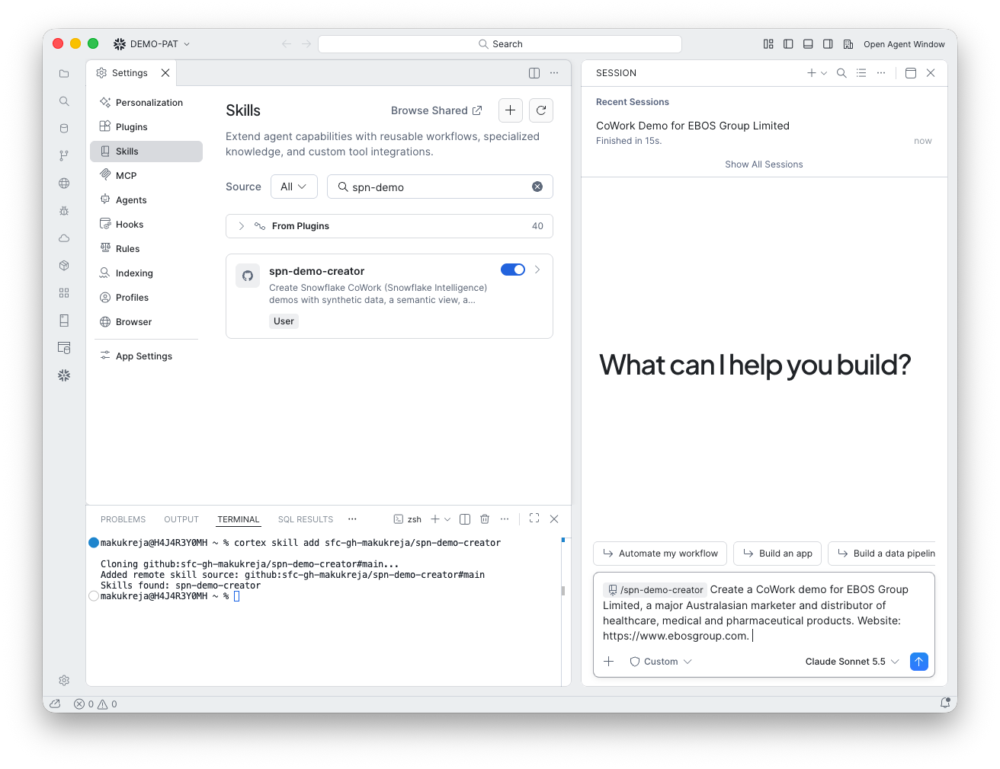
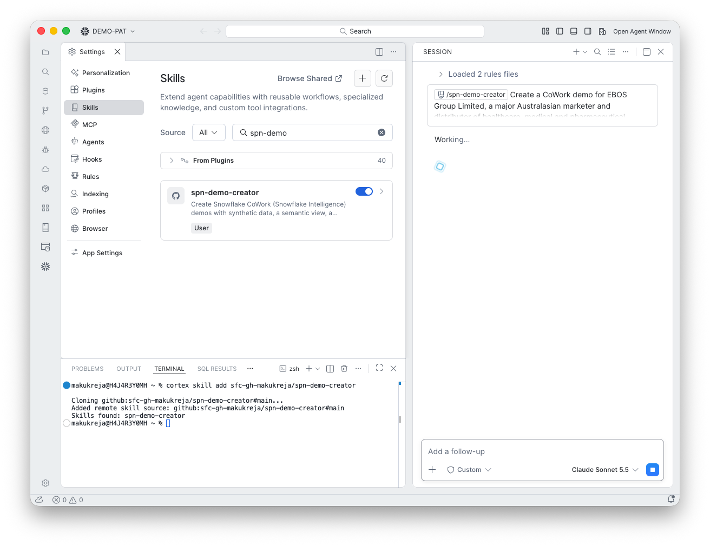

# 0. Choose the mode

**Goal:** Start the skill and tell it what you are demoing.

## What you do

Open a CoCo chat, type `/` and pick `spn-demo-creator`, then describe the demo. This run used customer mode:

```text
/spn-demo-creator Create a CoWork demo for EBOS Group Limited, a major Australasian
marketer and distributor of healthcare, medical and pharmaceutical products.
Website: https://www.ebosgroup.com.
```



CoCo loads the skill ("Used skill") and starts working.



!!! tip "Industry or customer?"
    Give a company and website for customer mode. Name only an industry, such as "retail in New Zealand", for industry mode. If you are not sure, the skill asks.

!!! warning "Open a project folder first"
    The Explorer in these screenshots shows "No folder opened". The skill then saved the demo script to the home directory. Open a folder before you start.
