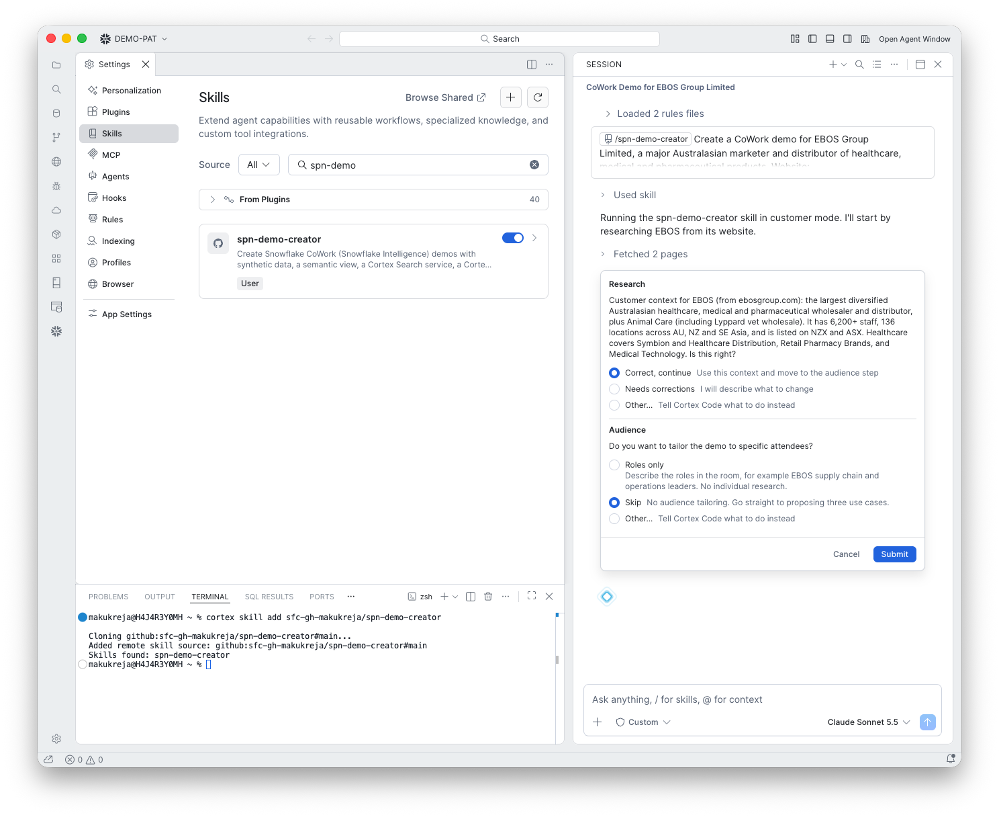

# 1. Research

**Goal:** Understand the customer well enough to propose realistic use cases.

## What happens

The skill fetched two pages from the customer's website and summarised them:

> The largest diversified Australasian healthcare, medical and pharmaceutical wholesaler and distributor, plus Animal Care (including Lyppard vet wholesale). 6,200+ staff, 136 locations across AU, NZ and SE Asia, listed on NZX and ASX. Healthcare covers Symbion and Healthcare Distribution, Retail Pharmacy Brands, and Medical Technology.

It asks you to confirm the summary.

## What you do

Choose **Correct, continue**, or **Needs corrections** and say what to change.

!!! warning "Check the research"
    The summary comes from the website and web search. Correct anything wrong now; the data, names and story are all built from it.

!!! note "No web search?"
    If web search is unavailable, the skill says so and marks the findings as unverified.
