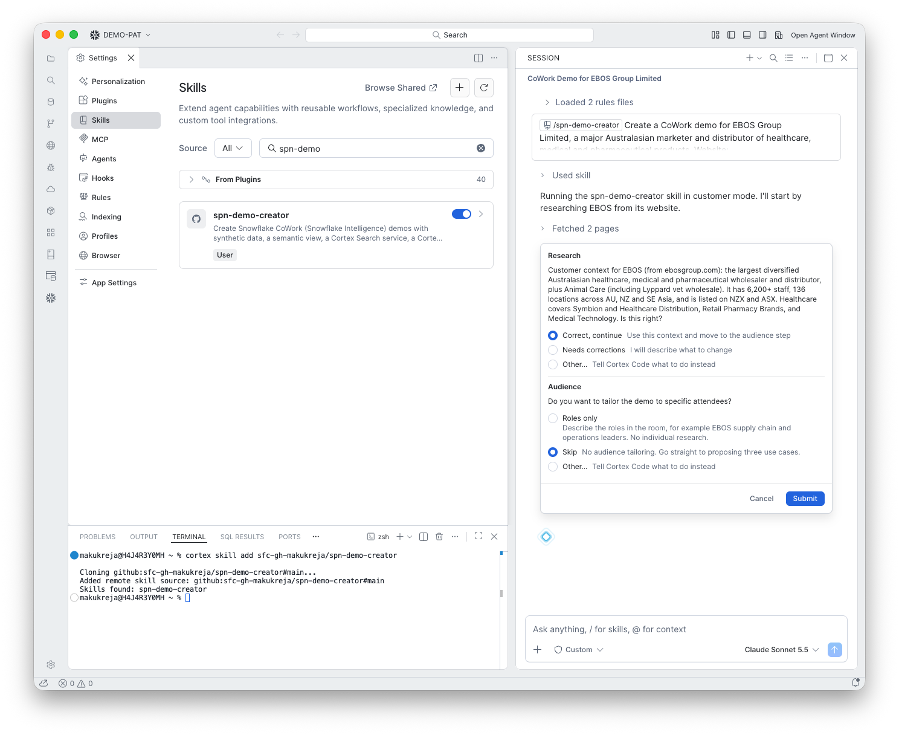

# 2. Audience

**Goal:** Tailor the demo to the people who will watch it.

## What happens

The same form asks whether to tailor the demo to specific attendees. The options are:

- **Roles only:** describe the roles in the room, such as supply chain and operations leaders. No individual research.
- **Skip:** no tailoring, go straight to three use cases.
- **Other:** tell the skill what to do.

This run chose **Skip**.

!!! tip "Use Roles only for a partner session"
    For a room of partner SEs and architects, **Roles only** gives sharper use cases than Skip, with no research on named people.

!!! note "Privacy"
    The skill never researches named individuals in industry mode. In customer mode it only does so if you provide names, using public professional information only.
