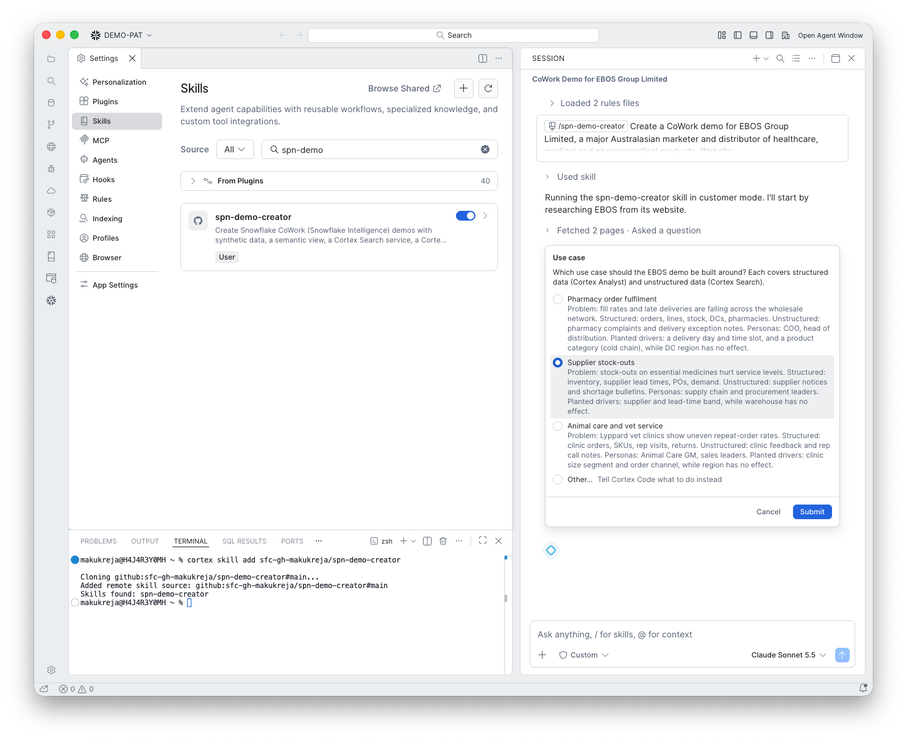
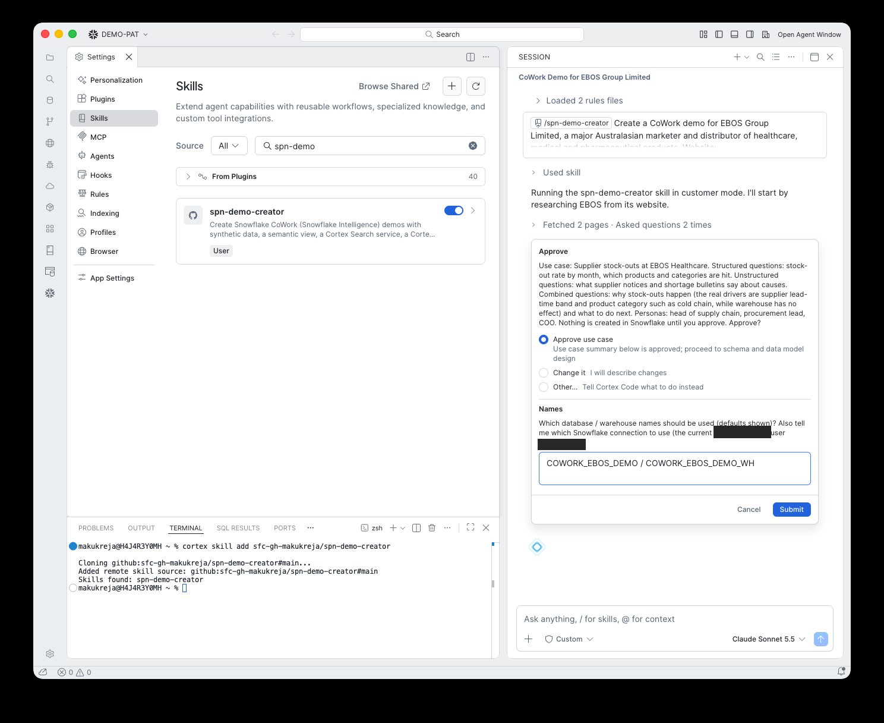

# 3. Use case

**Goal:** Pick one use case that needs both structured data and documents.

## What happens

The skill proposed three use cases. Each has a business problem, a structured data angle, an unstructured data angle, personas, and the planted drivers:

| Option | Problem |
|---|---|
| Pharmacy order fulfilment | Fill rates and late deliveries are falling across the wholesale network |
| **Supplier stock-outs** | Stock-outs on essential medicines hurt service levels |
| Animal care and vet service | Lyppard vet clinics show uneven repeat-order rates |

This run chose **Supplier stock-outs**. The skill then summarised it and asked for approval, and asked which database and warehouse names to use:

## What you do

Choose **Approve use case**. Type the database and warehouse names, or accept the defaults. This run used `COWORK_EBOS_DEMO / COWORK_EBOS_DEMO_WH`.

!!! danger "Nothing exists yet"
    No Snowflake object is created before you approve here. This is your last chance to change direction for free.

!!! tip "Names"
    You do not need the setup SQL to choose your own names. The skill creates the database and warehouse itself if your role can.

!!! note "Connection"
    The skill also reports which Snowflake connection it will use. Check it is the account you want.
