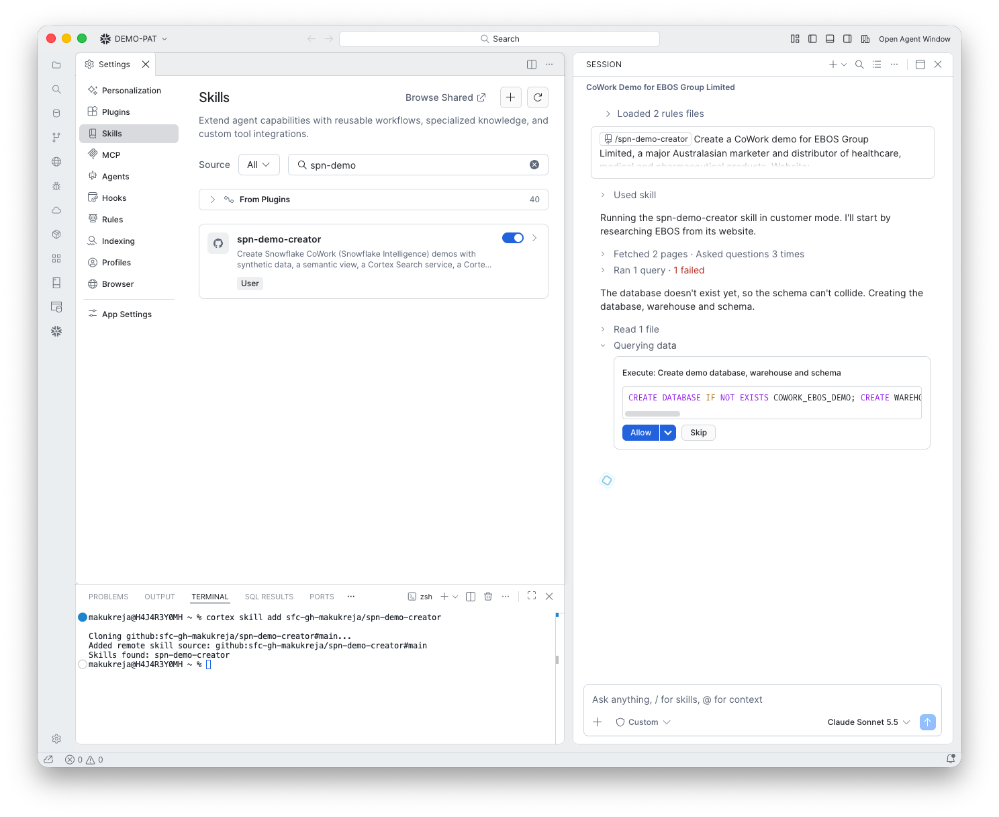

# 4. Create the schema

**Goal:** Set up a schema for the demo.

## What happens

The skill checked whether the database existed (the first query "failed" because it did not, which is expected), then asked to create the database, warehouse and schema.

## What you do

Click **Allow**. The schema is named after the demo: `COWORK_EBOS_DEMO.EBOS_SUPPLIER_STOCKOUTS`.

!!! note "A failed first query is normal"
    "Ran 1 query - 1 failed" at this point is the existence check. It is not an error.

!!! warning "Is the setup SQL needed?"
    Not for this step. `sql/00_setup.sql` is only needed for the optional email tool, or if you want the default names. The skill creates the database, warehouse and schema itself when your role allows it.
