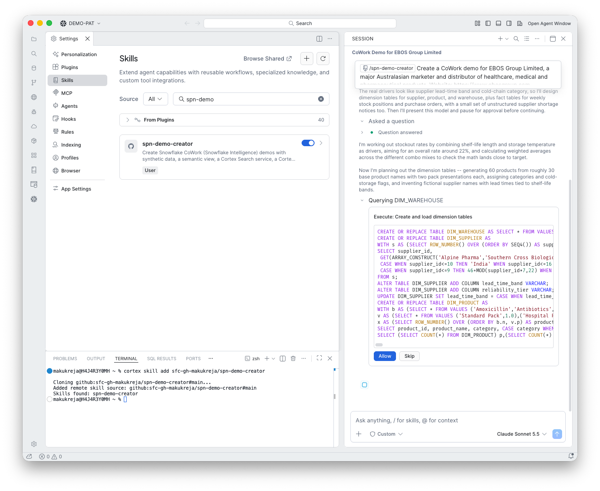
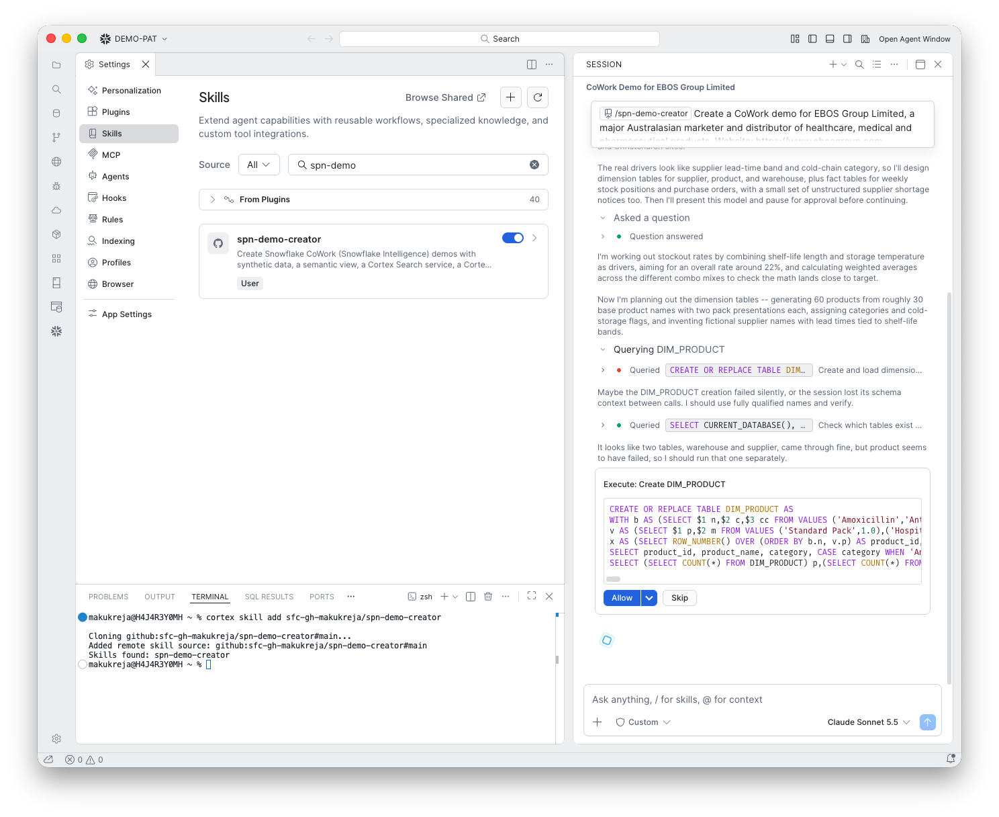
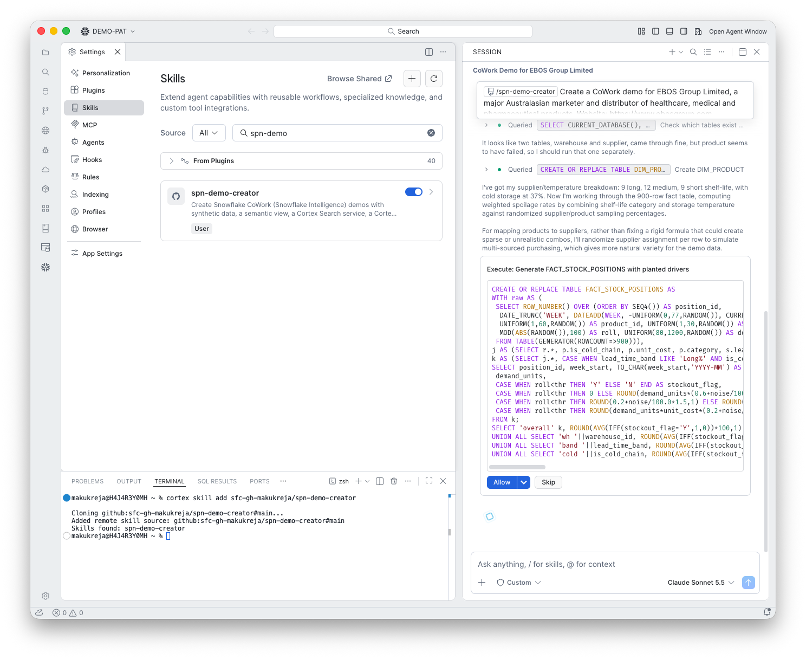
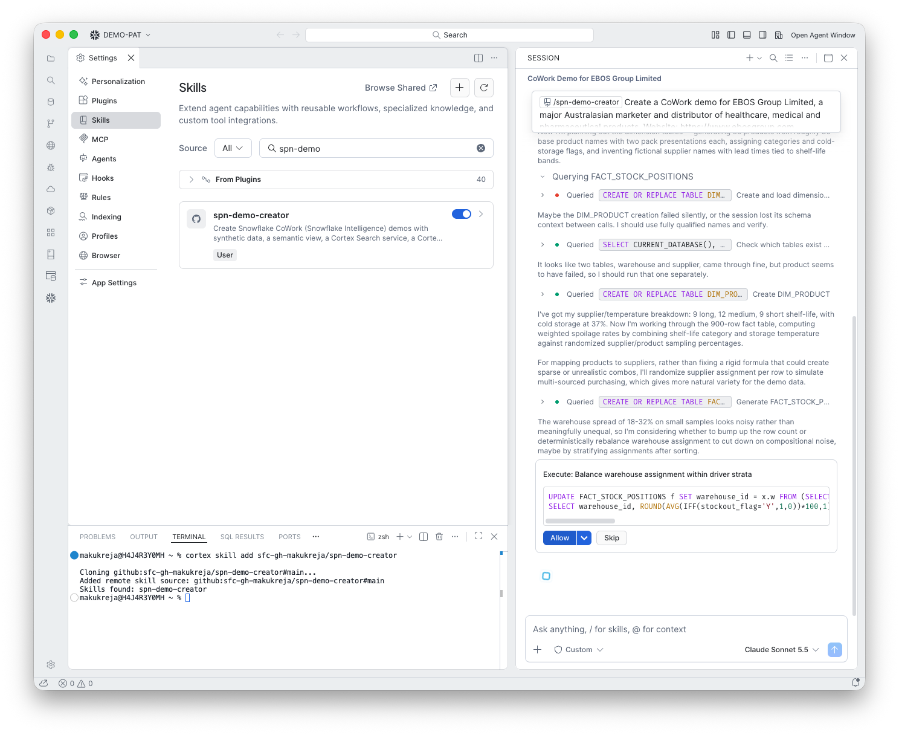
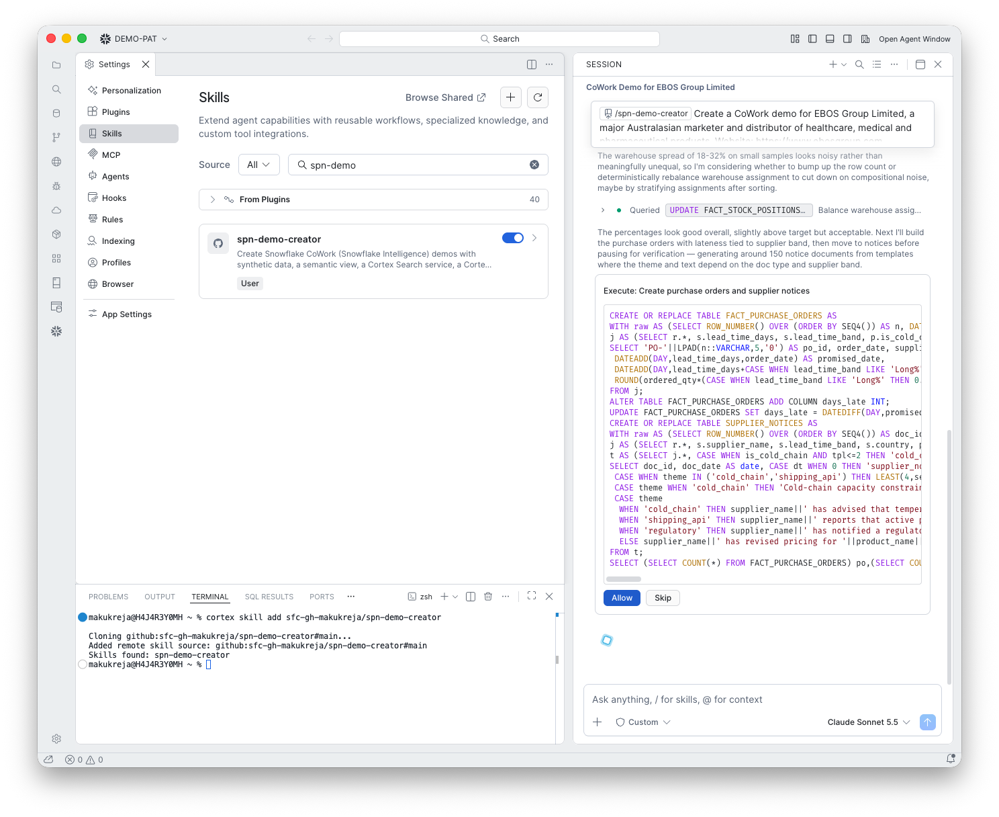
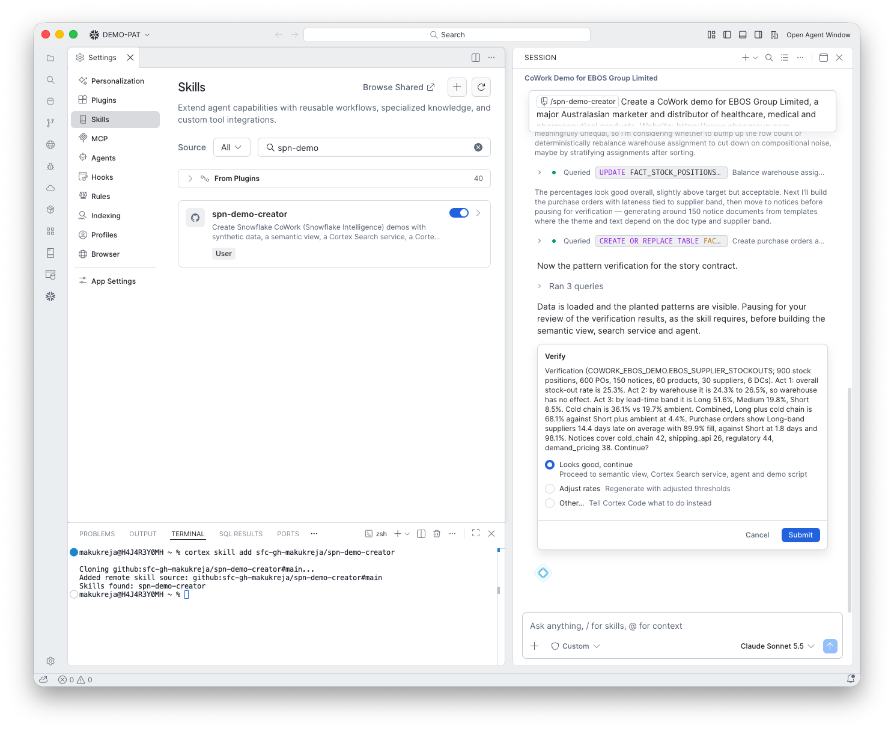

# 6. Generate the data

**Goal:** Create realistic data with the story built in, and prove the patterns are there.

## What happens

The skill created and loaded the dimension tables:

One of them failed quietly. `DIM_PRODUCT` was missing, and the skill noticed, checked which tables existed, and ran it again on its own:

Then the fact table, with the planted drivers (stock-outs depend on the lead-time band and cold chain, not on the warehouse):

The warehouse rates came out noisy (18 to 32%), so the skill rebalanced the warehouse assignment with an `UPDATE`:

Then the purchase orders and supplier notices:

## The pattern check

The skill ran three queries and showed the results for your approval:

| Act | Result |
|---|---|
| 1 What | Overall stock-out rate 25.3% |
| 2 Rule out | Warehouse 24.3% to 26.5%, no effect |
| 3 Drivers | Long lead time 51.6%, Medium 19.8%, Short 8.5%. Cold chain 36.1% against 19.7% ambient. Long plus cold chain 68.1% against 4.4% for short plus ambient |
| POs | Long-band suppliers deliver 14.4 days late (89.9% fill) against 1.8 days (98.1%) for Short |
| Notices | cold_chain 42, shipping_api 26, regulatory 44, demand_pricing 38 |

## What you do

Choose **Looks good, continue**, or **Adjust rates** to regenerate with new thresholds.

!!! warning "Gotcha: a table can fail silently"
    `DIM_PRODUCT` was missing after a multi-statement call. The skill caught it this time. The skill now runs one statement per call with fully qualified names and checks that every table exists.

!!! warning "Gotcha: the ruled-out dimension is noisy"
    Random assignment of the warehouse on a few hundred rows gave 18 to 32%, so the "no effect" act would not have held. The skill now assigns the ruled-out dimension round-robin within each segment.

!!! tip "Do not skip the check"
    This is the only point where you see the numbers before they are in the agent's answers. If the target rates are off, adjust now.
