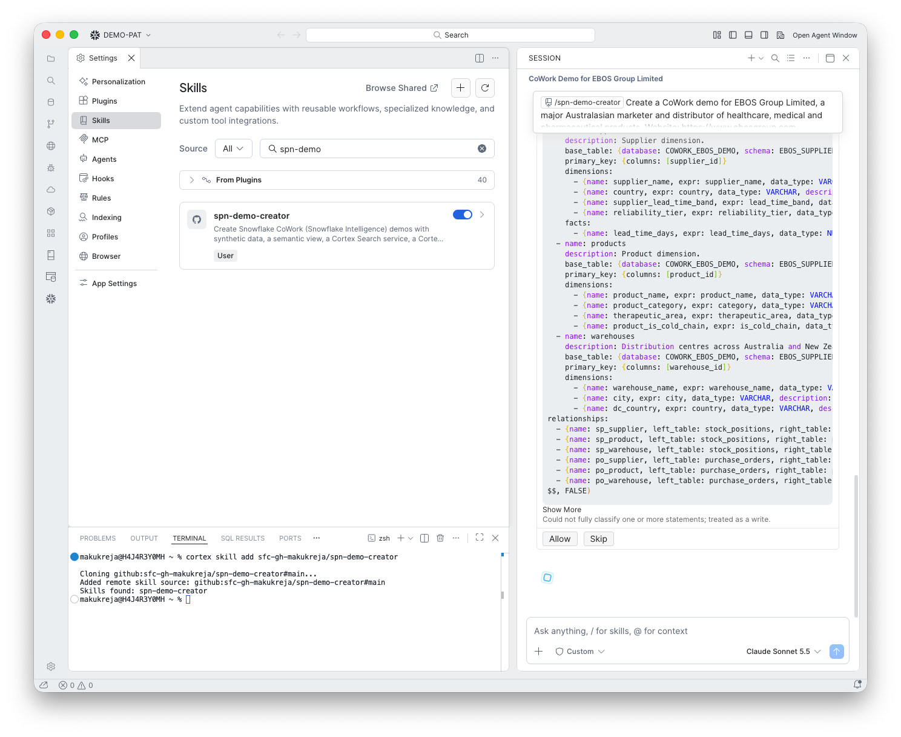

# 7. Semantic view

**Goal:** Give Cortex Analyst a business-friendly layer over the tables.

## What happens

The skill wrote the semantic view YAML (tables, primary keys, dimensions, facts, relationships) and created it with `SYSTEM$CREATE_SEMANTIC_VIEW_FROM_YAML` inline.

## What you do

Click **Allow**.

!!! note "\"Could not fully classify one or more statements\""
    CoCo shows this because the call is a stored procedure it cannot inspect. It is expected. Check the YAML above it and click **Allow**.

!!! success "The inline form works"
    The inline call with `FALSE` as the third argument created the view. No stage upload was needed.

!!! warning "Gotcha: no verified queries"
    The skill asks for eight verified queries. This run left them out ("I'll leave verified queries for later") and said so in its final message. The skill now says to add them before creating the view.
