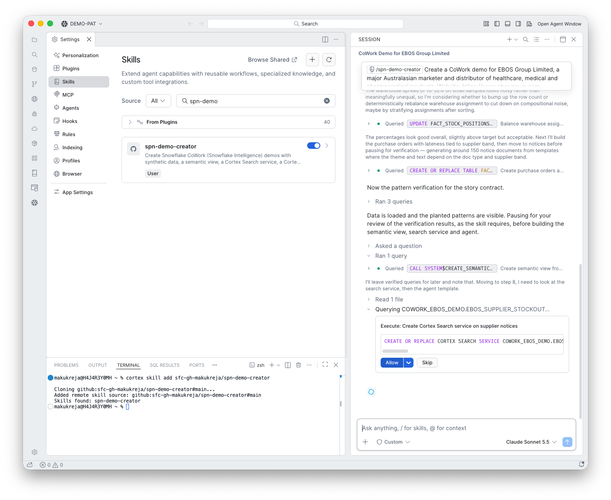

# 8. Cortex Search

**Goal:** Make the supplier notices searchable.

## What happens

The skill created a Cortex Search service on the notice text and waited for it to become ACTIVE.

## What you do

Click **Allow**. The service in this run was `SUPPLIER_NOTICES_SEARCH`, ACTIVE with 150 rows.

!!! note "Indexing takes a couple of minutes"
    If the agent cannot find notices straight away, wait two to three minutes and check `SHOW CORTEX SEARCH SERVICES`.
