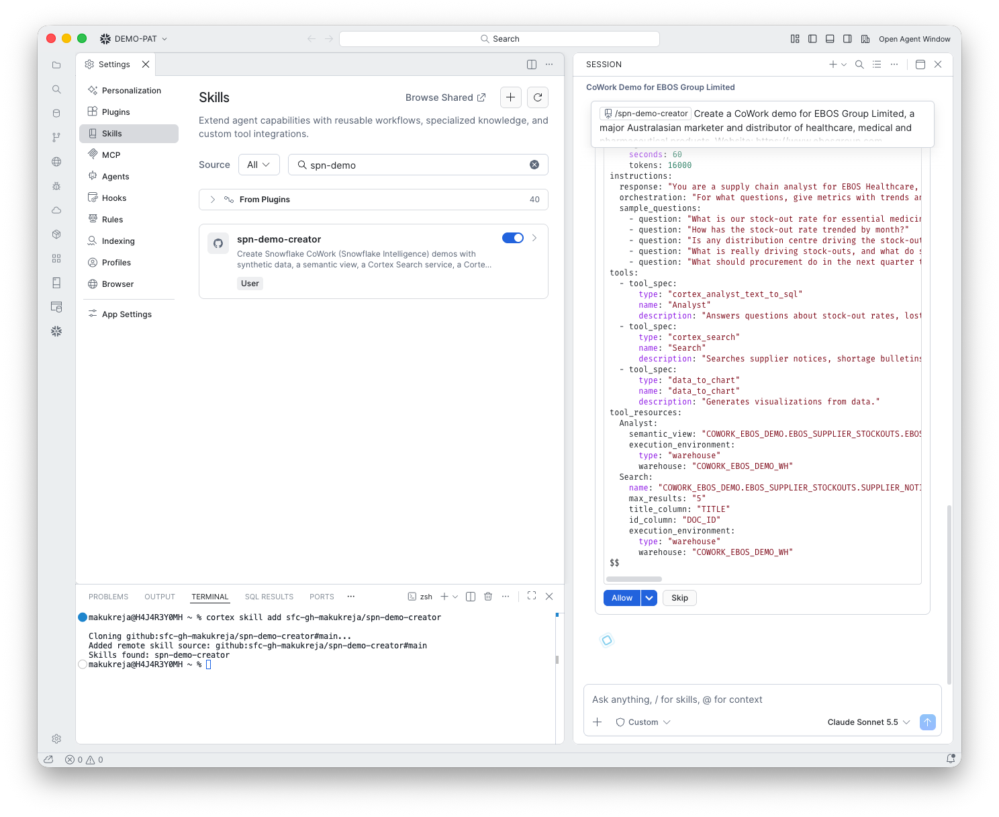

# 9. Cortex Agent

**Goal:** Bring the tools together in one agent.

## What happens

The skill created the agent `EBOS_SUPPLY_AGENT` with its instructions, five sample questions and its tools. The specification is shown for you to allow:

## What you do

Click **Allow**. Read the tools list in the specification first.

!!! warning "Gotcha: not every tool is included"
    This agent has **Analyst, Search and data_to_chart**. It has no `web_search` and no `send_email`. Email was skipped because it was not set up. The skill now includes `web_search` by default and lists any tool it leaves out.

!!! tip "Email is optional"
    Run `sql/00_setup.sql` as ACCOUNTADMIN to set up the notification integration and `SEND_MAIL` if you want question 6 to send a real email. Recipients must be verified in the account.
