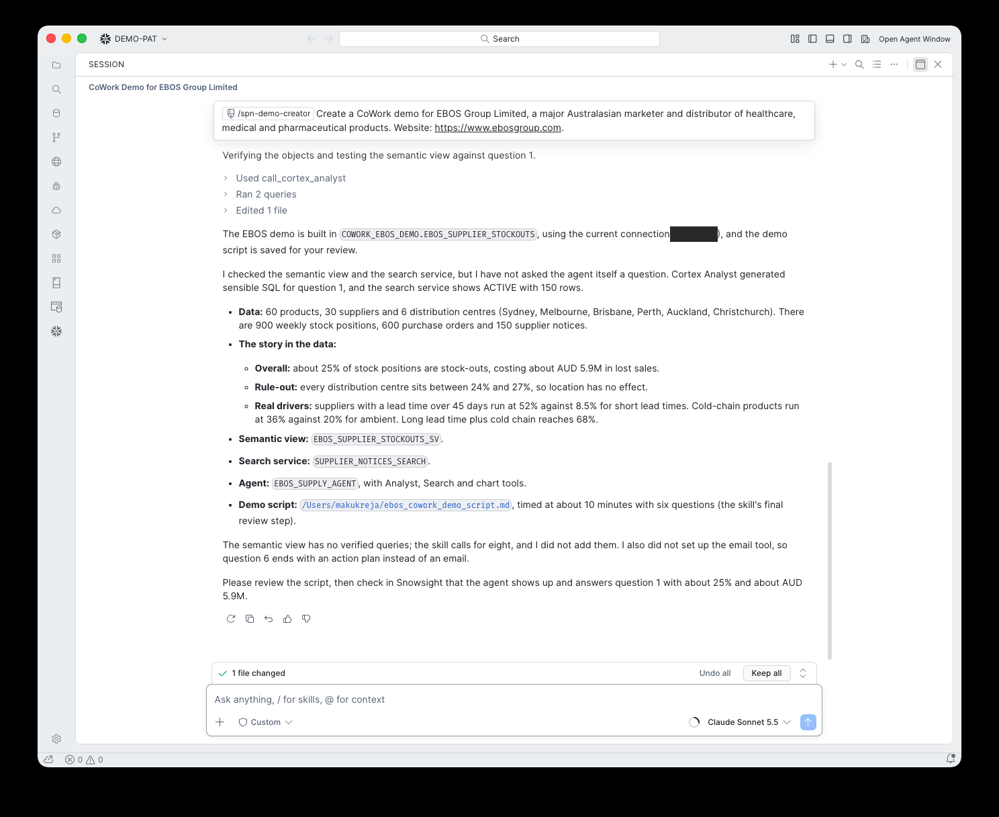

# 10. Sample questions

**Goal:** Check what was built and get six questions that build on each other.

## What happens

The skill tested the semantic view with Cortex Analyst for question 1, checked that the search service was ACTIVE, and summarised what it built:

- **Data:** 60 products, 30 suppliers, 6 distribution centres, 900 weekly stock positions, 600 purchase orders, 150 supplier notices
- **Overall:** about 25% of stock positions are stock-outs, costing about NZD 5.9M in lost sales
- **Rule out:** every distribution centre sits between 24% and 27%
- **Real drivers:** suppliers with lead times over 45 days run at 52% against 8.5% for short lead times; cold-chain products 36% against 20%; both together 68%

## What you do

Read the summary, then check the agent in Snowsight.

!!! warning "Gotcha: the agent itself was not tested"
    The skill ran Cortex Analyst on question 1 but did not ask the agent a question. Run [step 12](12-publish.md) to test and publish it, or ask question 1 yourself in CoWork. The skill now tries `DATA_AGENT_RUN` and says when it could not.

!!! note "Question 6"
    With no email tool, question 6 ends with an action plan instead of an email.
