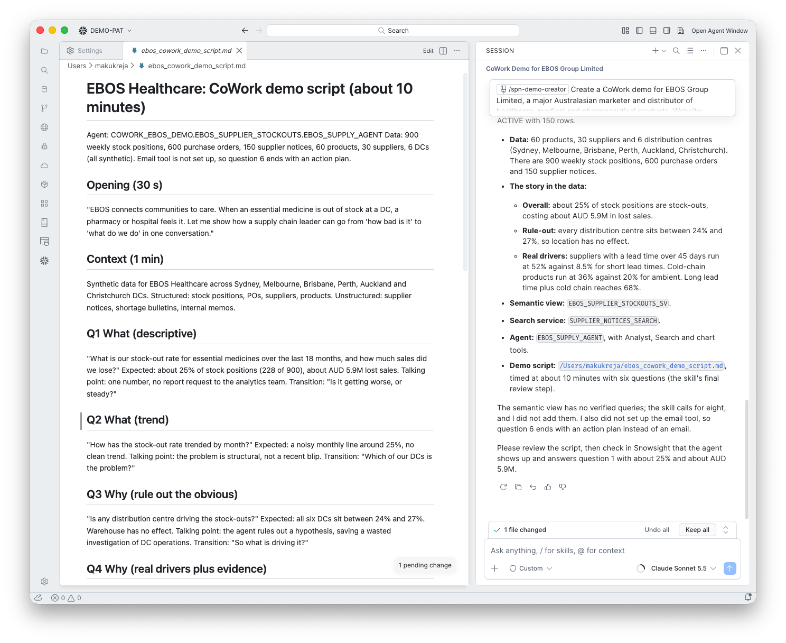

# 11. Demo script

**Goal:** A script you can present in about ten minutes.

## What happens

The skill wrote `ebos_cowork_demo_script.md` with an opening, context, six questions with the expected answer, talking points and the transition to the next, and a closing.

For example, question 3:

> "Is any distribution centre driving the stock-outs?" Expected: all six DCs between 24% and 27%. Warehouse has no effect. Talking point: the agent rules out a hypothesis, saving a wasted investigation of DC operations. Transition: "So what is driving it?"

## What you do

Review the script, run the questions in Snowsight, and check each answer against the expected one.

!!! warning "Gotcha: where the file lands"
    With no project folder open, the script was saved in the home directory (`~/ebos_cowork_demo_script.md`). Open a folder first, or move the file.

!!! tip "Rehearse once"
    Ask all six questions before the real demo. Keep screenshots of each answer as a fallback.
