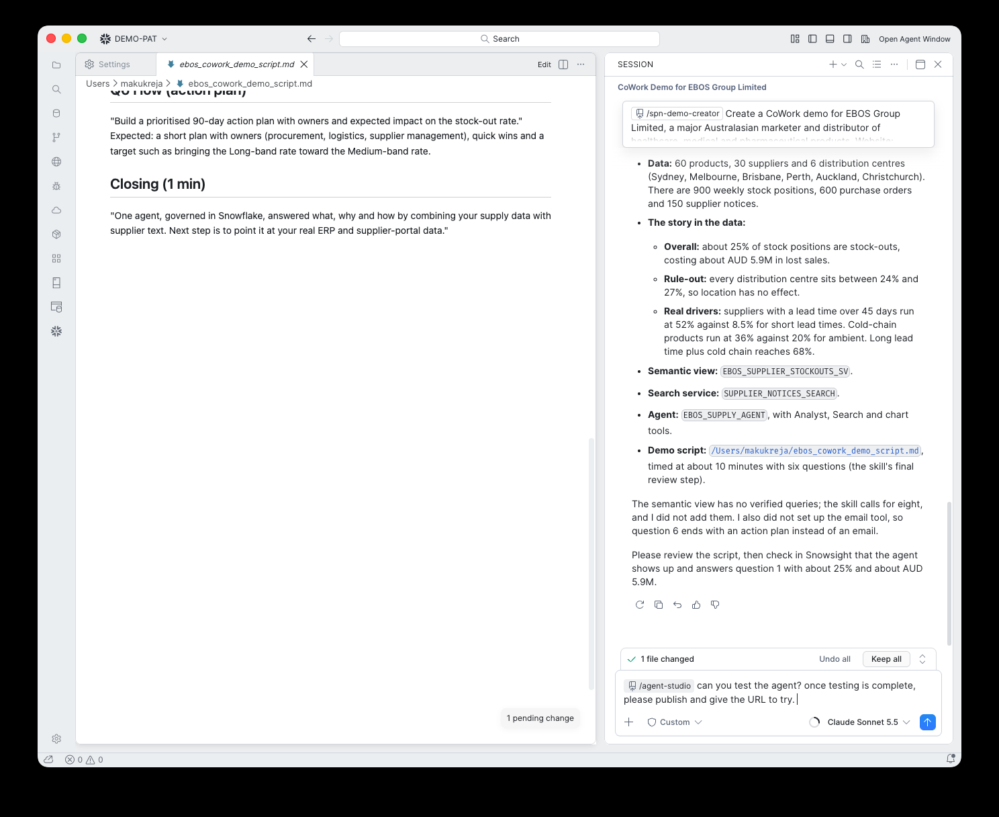
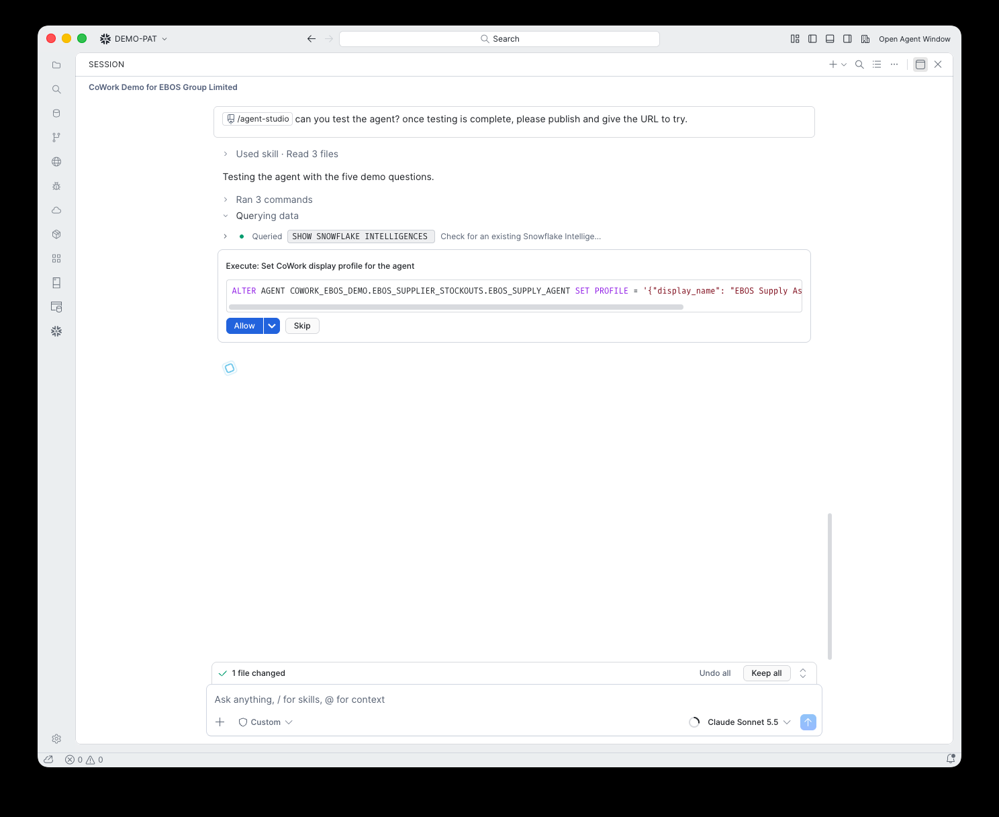
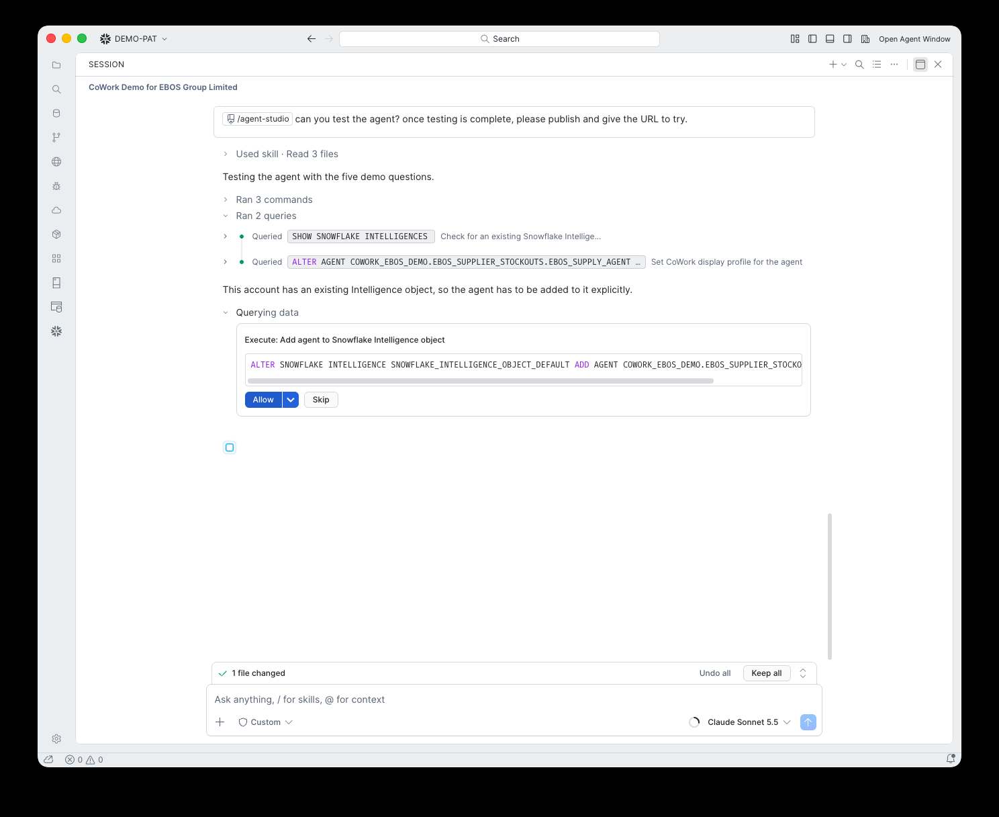
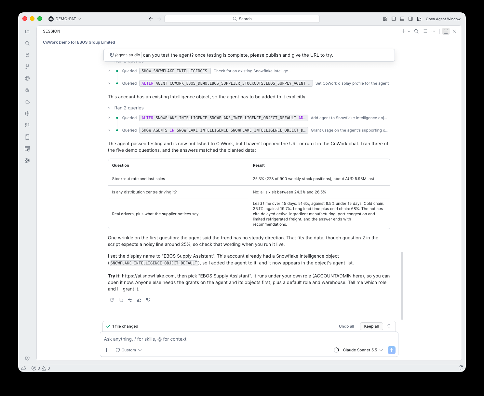
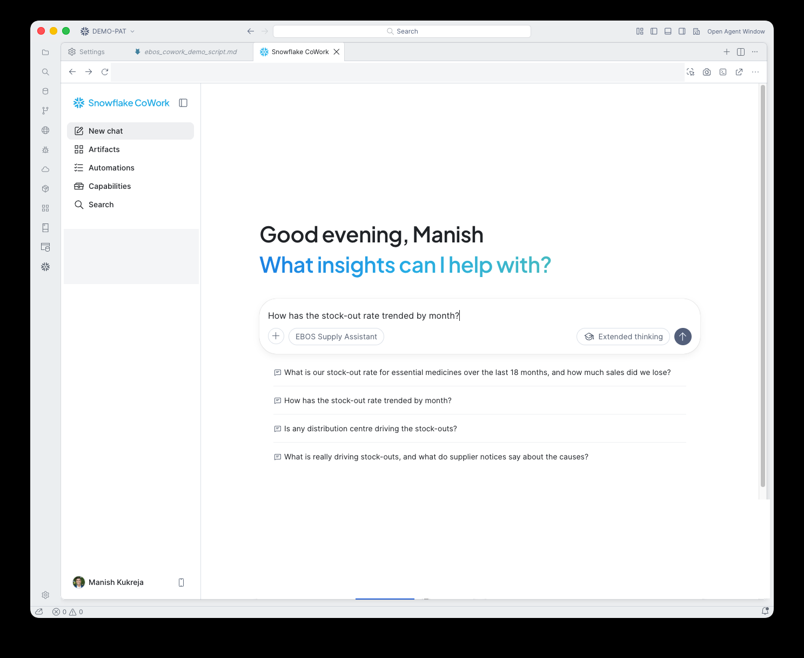
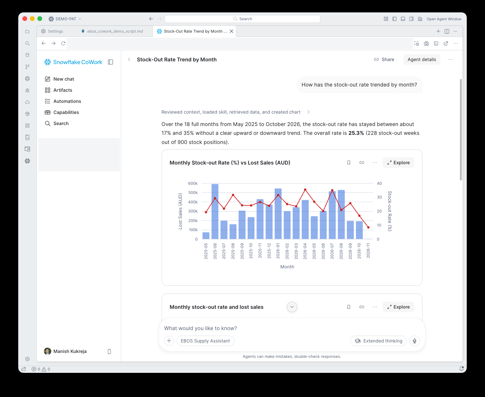
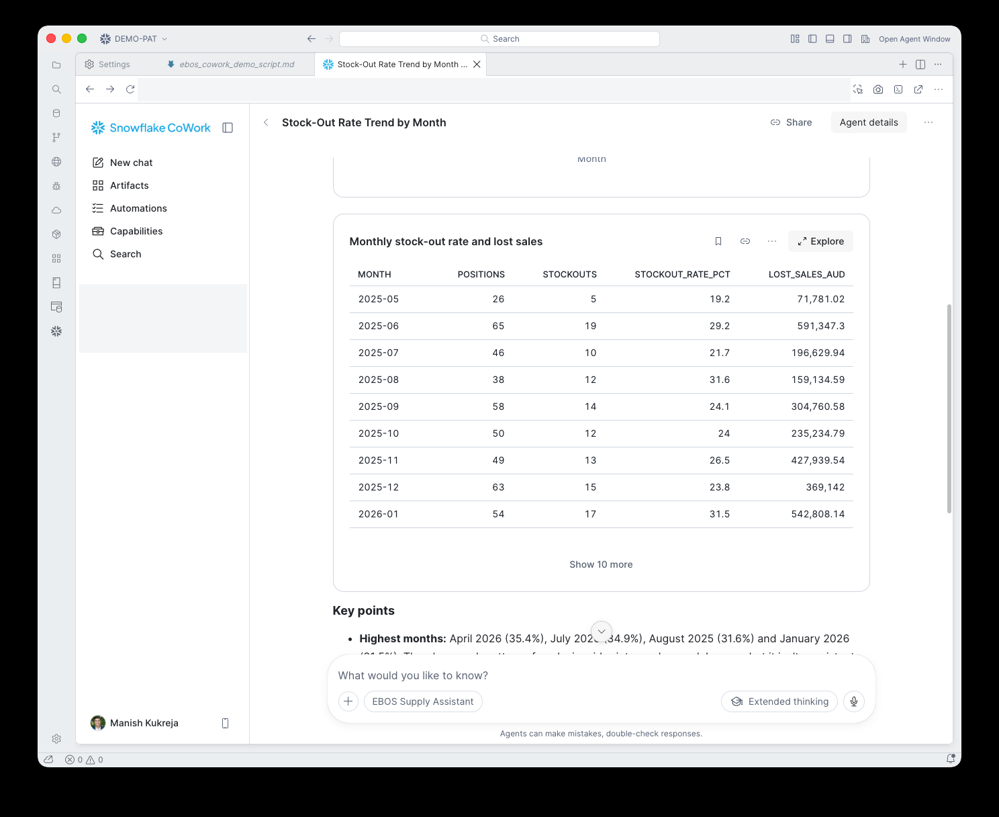
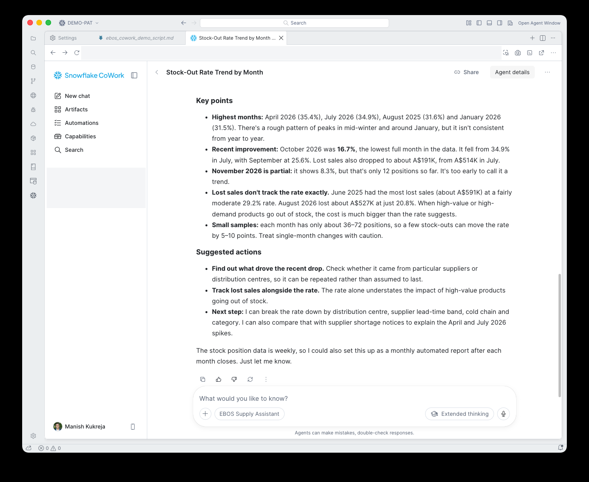

# 12. Test and publish to CoWork

**Goal:** Prove the agent works, give it a friendly name, and make it appear in Snowflake CoWork so you can present from it.

## What happens

In the EBOS run this was a second prompt, using the bundled `/agent-studio` skill:

> can you test the agent? once testing is complete, please publish and give the URL to try.

The assistant did four things:

1. Ran the demo questions against the agent with `cortex agents run`.
2. Set a display name with `ALTER AGENT ... SET PROFILE`.
3. Added the agent to the account's Snowflake Intelligence object with `ALTER SNOWFLAKE INTELLIGENCE ... ADD AGENT`.
4. Checked that the agent's supporting objects can be used, and returned the CoWork URL.

## What you do

Click **Allow** on each statement.

!!! warning "Gotcha: the account already had an Intelligence object"
    The assistant found `SNOWFLAKE_INTELLIGENCE_OBJECT_DEFAULT` already existed, so the agent had to be added to it explicitly. Until you do that, the agent does not show in CoWork.

Read the test summary. Three of the five questions were run, and the answers matched the planted data (25.3% stock-out, no distribution centre effect, lead time and cold chain as the drivers).

!!! note "Wrinkle: question 2"
    The agent said the monthly trend has "no steady direction". That is true of the data, but the script expected a noisy line around 25%. Check the wording against your script when you run it live.

## Open CoWork

Go to `https://ai.snowflake.com`, sign in with your account identifier, then choose the agent from the picker. Ask question 2 and the agent answers with a chart, a table and key points.

!!! tip "Warm it up"
    Ask one question about ten minutes before you present so the warehouse and agent are warm.

!!! warning "Gotcha: other users need grants"
    The agent runs under your own role, so you can open it straight away. Anyone else needs `USAGE` on the agent and its supporting objects, plus a default role and warehouse. See `sql/01_roles.sql`.

!!! warning "Gotcha: the sign-in page shows your account"
    The sign-in screens show your account identifier, username and URL. Do not publish screenshots of them.
